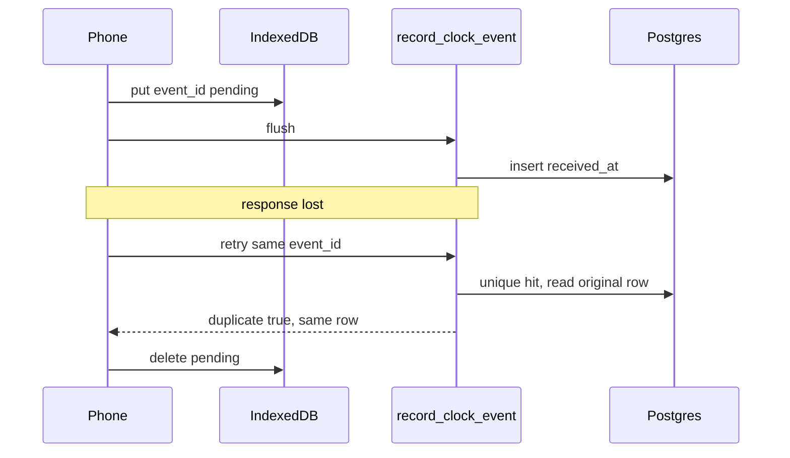

# Field clock reference

Reference build. Demo data. Not a client app.

This is a small public demo. It is not a client product. One signed-in user can clock in and clock out. The phone writes the event to IndexedDB first. The server keeps a single row when that same event is sent twice.

## Run it

```bash
npm install
npm run dev
```

Open the URL Vite prints. Sign in with a demo account after the steps below.

Day to day:

```bash
npm test
npx playwright test
```

`npm test` runs the queue tests. `npx playwright test` builds the app and serves it with `vite preview` so an offline reload can still open the cached shell.

## Environment

Copy `.env.example` to `.env.local`:

```bash
VITE_SUPABASE_URL=https://your-project.supabase.co
VITE_SUPABASE_ANON_KEY=your-anon-key
E2E_EMAIL=demo-a@fieldclock.test
E2E_PASSWORD=replace-with-the-demo-password
```

Use the anon key from Project Settings → API. Do not put the service role key in `.env.local`, in Vite env, or in git. `.env.local` is gitignored.

## Apply the SQL

1. In the Supabase SQL editor, run [`supabase/migrations/20261017000000_clock_events.sql`](supabase/migrations/20261017000000_clock_events.sql).
2. In Authentication → Providers → Email, turn off "Confirm email".
3. Create two users: `demo-a@fieldclock.test` and `demo-b@fieldclock.test`.
4. Run [`supabase/tests/rls_and_idempotency.sql`](supabase/tests/rls_and_idempotency.sql) in the SQL editor. A passing run prints `field clock checks passed`. If a run stops halfway, run `reset role;` and start the script again.

Optional CLI path, after `supabase init` in this folder (keep the existing `supabase/migrations` files):

```bash
supabase link --project-ref <project-ref>
supabase db push
```

Do not commit the project ref or any key.

## Sent twice, one row kept

The phone generates `event_id` and stores the event before it calls the network. `record_clock_event` inserts that id once. A retry, including a retry after a lost response, finds the same `(user_id, event_id)` and returns the original row. `device_time` is the time the phone claimed. `received_at` is the database clock.



On screen, Sync Now flushes the queue. Send again submits that same `event_id` a second time. The list still has one row, and the table still has one row for that id.

## Tests

- `npm test` checks queue order, a failed flush left pending, a successful flush removed, the same event enqueued twice stored once, a duplicate response removed, a rejected event not blocking the next one, and a `flushing` row retried once after reload.
- The SQL script checks that user A cannot read user B, a duplicate `event_id` returns the original row, and an invalid clock-in or clock-out returns a reason and writes nothing.
- Playwright, when `.env.local` is set, goes offline, clocks in, checks that no RPC was sent, reloads, still sees `1 waiting`, syncs, sends that event again, and expects one row.

## Loom shot list

About 2–3 minutes. Record it yourself.

1. Airplane mode. Clock in. The badge reads `Offline · 1 waiting`.
2. Reconnect. Sync Now. The row shows the claimed device time and `received_at`.
3. Send again. The list still has one row. Open the table and show one `(user_id, event_id)`, with both timestamps visible.

## iPhone checklist

This is manual. There is no automated iOS run. The service worker only installs on HTTPS (or `localhost` on that phone). A plain `http://` LAN address will not cache the shell.

```bash
npm run build
npm run preview -- --host 127.0.0.1 --port 4173
```

Point a quick HTTPS tunnel at `http://127.0.0.1:4173`. Load the tunneled URL once while online, then:

- [ ] Add to Home Screen
- [ ] Turn on airplane mode
- [ ] Clock in
- [ ] Confirm the badge shows `1 waiting`
- [ ] Force-quit the app
- [ ] Set the phone clock forward
- [ ] Relaunch and confirm the event is still waiting
- [ ] Turn the network back on and tap Sync Now
- [ ] Tap Send again
- [ ] Confirm the database has one row, and the claimed time differs from `received_at` when the phone clock was wrong

## Intentionally simplified

Demo email and password only. There is no offline login. Queued events stay on the device after sign-out and flush when that same user signs in again.

The button follows the local queue so a second offline tap does not enqueue another clock-in. The server still rejects a stale or repeated state. "Already clocked in" follows `received_at` order. A validation failure is shown and not retried, so one bad event does not block the queue. A network failure stays pending.

The future-clock window is 5 minutes. Older offline events are accepted. `navigator.onLine` can be wrong on iOS; Sync Now and opening the tab again are the recovery. `navigator.storage.persist()` is requested once after sign-in and may be denied. The app does not depend on that grant.

The service worker caches the app shell only. It does not cache Supabase, and it does not use Background Sync. Two tabs share a Web Lock when the browser has one. The unique key is what keeps a duplicate event to one row.

Out of scope: checklist "Mark done", My Day, map pins, photos, push notifications, multi-device conflict resolution, offline login, a custom conflict UI, production hosting, and any client branding.
